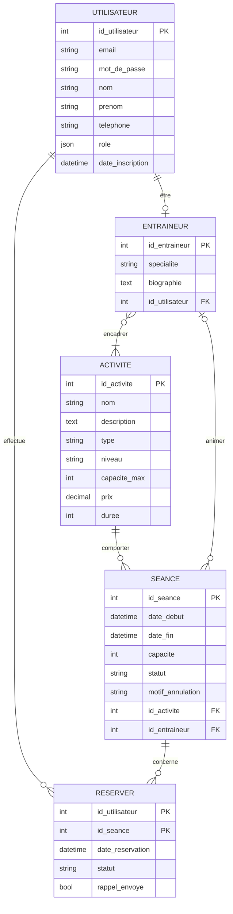

# ReservationApp
Application de réservation de séances sportifs
<br>
Link: http://192.168.105.108:8000/ReservApp/public/
<br>
PHP 8.4.26 <br>
Symfony CLI 5.22.2<br>
Composer 2.11.1<br>
<br>
https://192.168.105.108/adminer.php<br>
sardsql (id, mdp)
<br>
MCD:


[README-suivi.md](https://github.com/user-attachments/files/35077432/README-suivi.md)
# 🏅 Centre sportif — Système de réservation

> Application web Symfony permettant aux membres de réserver des séances d'activités sportives
> (tennis, yoga, natation…), avec gestion des membres, des activités, des entraîneurs et des
> plannings en temps réel.


---

## 📊 Avancement global

| # | Étape | Statut |
|:-:|---|:-:|
| 0 | Mise en place du projet | ⬜ À faire |
| 1 | Conception (MCD / MLD) | ⬜ À faire |
| 2 | Gestion des utilisateurs | ⬜ À faire |
| 3 | Gestion des activités | ⬜ À faire |
| 4 | Réservation de créneaux | ⬜ À faire |
| 5 | Gestion des entraîneurs | ⬜ À faire |
| 6 | Notifications par email | ⬜ À faire |
| 7 | Statistiques et suivi | ⬜ À faire |
| 8 | Tests, finitions et livraison | ⬜ À faire |

<sub>Légende : ⬜ À faire · 🟨 En cours · ✅ Terminé</sub>

---

## 0. Mise en place du projet

- [ ] Créer le projet : `symfony new centre-sportif --version="7.3.*" --webapp`
- [ ] Créer le dépôt GitHub et faire le premier commit
- [ ] Configurer `.env.local` (base de données, `MAILER_DSN`, `MAILER_FROM`)
- [ ] Installer les extensions Twig : `composer require twig/intl-extra twig/string-extra`
- [ ] Créer la base : `php bin/console doctrine:database:create`
- [ ] Mettre en place le template de base (`base.html.twig` + Bootstrap 5 + menu)
- [ ] Installer un outil de test des emails (Mailpit ou MailHog)

## 1. Conception

- [ ] Rédiger le dictionnaire de données
- [ ] Réaliser le MCD (entités, associations, cardinalités)
- [ ] Déduire le MLD
- [ ] Valider le modèle avec le formateur

<details>
<summary>📐 Voir le MCD / MLD</summary>



**MLD**
- UTILISATEUR (<u>id_utilisateur</u>, email, mot_de_passe, nom, prenom, telephone, role, date_inscription)
- ENTRAINEUR (<u>id_entraineur</u>, specialite, biographie, #id_utilisateur)
- ACTIVITE (<u>id_activite</u>, nom, description, type, niveau, capacite_max, prix, duree)
- SEANCE (<u>id_seance</u>, date_debut, date_fin, capacite, statut, motif_annulation, #id_activite, #id_entraineur)
- ENCADRER (<u>#id_entraineur, #id_activite</u>)
- RESERVER (<u>#id_utilisateur, #id_seance</u>, date_reservation, statut, rappel_envoye)

</details>

## 2. Gestion des utilisateurs (membres)

**Modèle**
- [ ] Entité `User` (email, mot de passe, nom, prénom, téléphone, rôles, date d'inscription)
- [ ] Migration et création de la table

**Authentification (Security de Symfony)**
- [ ] Configurer `security.yaml` (provider, firewall, `form_login`, `logout`)
- [ ] Définir la hiérarchie des rôles : `ROLE_MEMBRE` < `ROLE_COACH` < `ROLE_ADMIN`
- [ ] Page d'inscription (`/inscription`) avec mot de passe haché
- [ ] Page de connexion / déconnexion (`/connexion`, `/deconnexion`)
- [ ] Protéger les routes (`access_control` + `#[IsGranted]`)
- [ ] Créer le premier compte administrateur

**Profil**
- [ ] Page profil : affichage des informations personnelles
- [ ] Formulaire de modification du profil
- [ ] Historique des réservations (à venir / passées / annulées)

## 3. Gestion des activités

**Modèle**
- [ ] Entité `Activite` (nom, description, type, niveau, capacité max, prix, durée)
- [ ] Entité `Seance` (début, fin, capacité, statut) liée à une activité
- [ ] Relation activité ↔ entraîneurs (ManyToMany)

**Administration**
- [ ] Liste des activités (admin)
- [ ] Créer une activité
- [ ] Modifier une activité
- [ ] Supprimer une activité (avec confirmation + CSRF)
- [ ] Associer un ou plusieurs entraîneurs à une activité
- [ ] Définir le calendrier : ajouter / modifier les séances d'une activité

**Côté membre**
- [ ] Catalogue des activités disponibles
- [ ] Filtre par type d'activité
- [ ] Filtre par niveau de difficulté
- [ ] Filtre par date
- [ ] Page détail d'une activité avec ses créneaux à venir

## 4. Réservation de créneaux

- [ ] Entité `Reservation` (membre, séance, date, statut)
- [ ] Afficher les créneaux disponibles et les places restantes
- [ ] Bouton « Réserver » (membre connecté uniquement)
- [ ] Empêcher la double réservation d'une même séance
- [ ] Empêcher la réservation d'une séance complète, passée ou annulée
- [ ] Gérer l'accès concurrent à la dernière place (verrou en base)
- [ ] Annulation d'une réservation par le membre
- [ ] Mise à jour des places en temps réel (route `/api/places` + rafraîchissement JS)
- [ ] *(Bonus)* Temps réel par push avec Mercure / Turbo Streams

## 5. Gestion des entraîneurs

**Administration**
- [ ] Entité `Entraineur` (spécialité, biographie) liée à un `User`
- [ ] Liste des entraîneurs
- [ ] Ajouter un entraîneur (création du compte + rôle `ROLE_COACH`)
- [ ] Modifier un entraîneur
- [ ] Supprimer un entraîneur

**Espace entraîneur**
- [ ] Page « Mon planning » (séances à venir)
- [ ] Liste des inscrits d'une séance
- [ ] Modifier une de ses séances
- [ ] Annuler une de ses séances (avec motif)
- [ ] Voter : un entraîneur ne peut gérer que **ses** séances

## 6. Notifications par email

- [ ] Configurer Symfony Mailer
- [ ] Service `NotificationMailer` + template email commun
- [ ] Email de confirmation de réservation
- [ ] Email d'annulation de réservation
- [ ] Email d'annulation de séance (à tous les inscrits)
- [ ] Email de rappel avant la séance (commande `app:rappels`)
- [ ] Planifier la commande de rappel (cron toutes les heures)
- [ ] Page admin d'envoi d'emails groupés (tous les membres ou membres d'une activité)
- [ ] *(Bonus)* Envoi asynchrone avec Messenger

## 7. Statistiques et suivi des activités

- [ ] Tableau de bord admin
- [ ] Nombre total de réservations
- [ ] Réservations par activité
- [ ] Réservations par mois (graphique)
- [ ] Répartition par type d'activité (graphique)
- [ ] Activités les plus populaires
- [ ] Taux d'occupation des créneaux
- [ ] Filtre par année

## 8. Tests, finitions et livraison

- [ ] Jeu de données de test (fixtures : admin, entraîneurs, membres, activités, séances)
- [ ] Tester chaque rôle (membre, entraîneur, admin)
- [ ] Vérifier la sécurité (accès interdits, CSRF, mots de passe hachés)
- [ ] Vérifier l'affichage mobile
- [ ] Tests unitaires / fonctionnels (PHPUnit)
- [ ] Rédiger la documentation d'installation
- [ ] Captures d'écran dans le README
- [ ] Préparer la présentation / démonstration

---

## 🚀 Installation

```bash
git clone https://github.com/<utilisateur>/<depot>.git
cd <depot>
composer install
# Créer .env.local à partir de .env (DATABASE_URL, MAILER_DSN, MAILER_FROM)
php bin/console doctrine:database:create
php bin/console doctrine:migrations:migrate
symfony serve
```

## 🧱 Technologies

- Symfony 7 (Security, Doctrine, Twig, Mailer, Forms)
- MySQL / MariaDB
- Bootstrap 5, Chart.js
