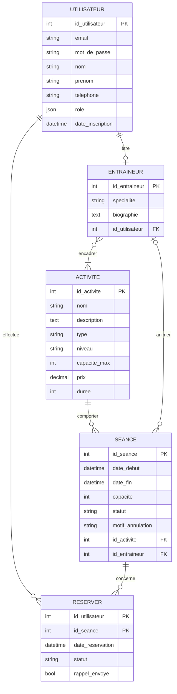

# ReservationApp
Application de réservation de séances sportifs

Link: http://192.168.105.108:8000/inscription/

PHP 8.4.26
Symfony CLI 5.22.2
Composer 2.11.1

MCD:


<!--
  À adapter avant de publier :
  - remplace UTILISATEUR/DEPOT par ton pseudo GitHub et le nom du dépôt (Ctrl+H dans l'éditeur)
  - vérifie que les numéros d'Issues (1 à 9) correspondent bien aux tiens
-->

# 🏅 Centre sportif — Système de réservation

> Application web Symfony permettant aux membres de réserver des séances d'activités sportives
> (tennis, yoga, natation…), avec gestion des membres, des activités, des entraîneurs et des
> plannings en temps réel.


---

## 📋 Suivi de l'avancement

Le détail de chaque étape (avec les tâches à cocher) se trouve dans les Issues.
Le statut se met à jour tout seul : **open** = en cours, **closed** = terminée.

| # | Étape | Issue | Statut |
|:-:|---|:-:|:-:|
| 0 | Mise en place du projet | [#1](https://github.com/BarbereauM/ReservationApp/issues/1) |  |
| 1 | Conception (MCD / MLD) | [#2](https://github.com/BarbereauM/ReservationApp/issues/2) |  |
| 2 | Gestion des utilisateurs | [#3](https://github.com/BarbereauM/ReservationApp/issues/3) |  |
| 3 | Gestion des activités | [#4](https://github.com/BarbereauM/ReservationApp/issues/4) |  |
| 4 | Réservation de créneaux | [#5](https://github.com/BarbereauM/ReservationApp/issues/5) |  |
| 5 | Gestion des entraîneurs | [#6](https://github.com/BarbereauM/ReservationApp/issues/6) |  |
| 6 | Notifications par email | [#7](https://github.com/BarbereauM/ReservationApp/issues/7) |  |
| 7 | Statistiques et suivi | [#8](https://github.com/BarbereauM/ReservationApp/issues/8) |  |
| 8 | Tests, finitions et livraison | [#9](https://github.com/BarbereauM/ReservationApp/issues/9) |  |

👉 [Voir toutes les Issues](https://github.com/BarbereauM/ReservationApp/issues?q=is%3Aissue)

---

## ✨ Fonctionnalités

| Rôle | Ce qu'il peut faire |
|---|---|
| **Membre** | S'inscrire, se connecter, filtrer les activités, réserver / annuler une séance, consulter son historique |
| **Entraîneur** | Consulter son planning, voir les inscrits, modifier ou annuler ses séances |
| **Administrateur** | Gérer les activités, les séances et les entraîneurs, envoyer des emails groupés, consulter les statistiques |

<details>
<summary>📐 Modèle de données (MCD / MLD)</summary>



**MLD**
- UTILISATEUR (<u>id_utilisateur</u>, email, mot_de_passe, nom, prenom, telephone, role, date_inscription)
- ENTRAINEUR (<u>id_entraineur</u>, specialite, biographie, #id_utilisateur)
- ACTIVITE (<u>id_activite</u>, nom, description, type, niveau, capacite_max, prix, duree)
- SEANCE (<u>id_seance</u>, date_debut, date_fin, capacite, statut, motif_annulation, #id_activite, #id_entraineur)
- ENCADRER (<u>#id_entraineur, #id_activite</u>)
- RESERVER (<u>#id_utilisateur, #id_seance</u>, date_reservation, statut, rappel_envoye)

</details>

---

## 🚀 Installation

```bash
git clone https://github.com/BarbereauM/ReservationApp.git
cd DEPOT
composer install
# Créer .env.local à partir de .env (DATABASE_URL, MAILER_DSN, MAILER_FROM)
php bin/console doctrine:database:create
php bin/console doctrine:migrations:migrate
symfony serve
```

## 🧱 Technologies

- Symfony 7 (Security, Doctrine, Twig, Mailer, Forms)
- MySQL / MariaDB
- Bootstrap 5, Chart.js
